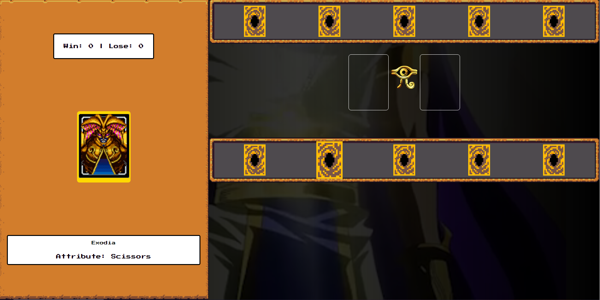
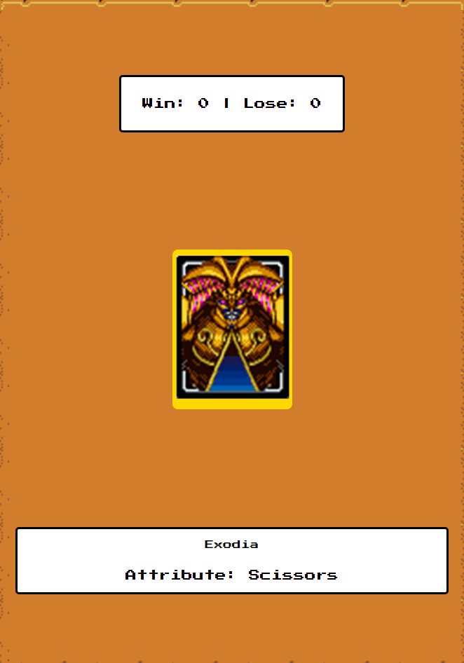

# Yu-gi-oh

Bem-vindo ao repositório do Jogo de Yu-gi-oh! Este é um jogo web simples onde você compete contra o computador em uma partida de "Pedra, Papel e Tesoura" com cartas.



## Descrição

Neste jogo, você e o computador recebem 5 cartas, cada uma representando "Pedra", "Papel" ou "Tesoura". Você escolhe uma das suas cartas, e o computador escolhe aleatoriamente uma das dele. O vencedor da rodada é determinado pelas regras do "Pedra, Papel e Tesoura". O objetivo é vencer o computador em uma série de rodadas e alcançar o placar mais alto.

## Tecnologias

- HTML5
- CSS3
- JavaScript (sem frameworks)

## Como Jogar

1. Abra o jogo no navegador (veja as instruções abaixo).
2. Você e o computador recebem 5 cartas, representando "Pedra", "Papel" ou "Tesoura".
3. Escolha uma das suas cartas para jogar.
4. O computador escolherá aleatoriamente uma carta.
5. O vencedor da rodada é determinado pelas regras do "Pedra, Papel e Tesoura".
6. O placar é atualizado após cada rodada.
7. Continue jogando para tentar vencer o computador.

## Instruções de Instalação e Uso

1. Clone este repositório:

   ```bash
   git clone https://github.com/oyazigi/Yu-gi-oh-game.git
   cd Yu-gi-oh-game
   ```

2. Inicie um servidor local na pasta do projeto (recomendado, para que a música e os vídeos carreguem corretamente). Escolha uma das opções:

   - **VS Code:** instale a extensão *Live Server*, clique com o botão direito em `index.html` e escolha **Open with Live Server**.
   - **Node.js:** `npx serve .`
   - **Python:** `python3 -m http.server 8000`

3. Acesse o endereço exibido no terminal (por exemplo, `http://localhost:8000`) e jogue clicando nas cartas.

Não é necessário instalar dependências: o projeto é 100% front-end.

## Placar

O jogo acompanha o placar das rodadas, mostrando quantas vezes você venceu e quantas vezes o computador venceu. O objetivo é alcançar o placar mais alto e derrotar o computador!



## Contribuições

Contribuições para este projeto são bem-vindas! Abra uma *issue* ou envie um *pull request*.

## Contato

Se você tiver alguma pergunta ou feedback, entre em contato comigo:

- **Victor Yazigi**
- E-mail: victoryazigicontv@gmail.com
- LinkedIn: [linkedin.com/in/victor-yazigi-75549521a](https://www.linkedin.com/in/victor-yazigi-75549521a/)

## Status do Projeto

Estável
